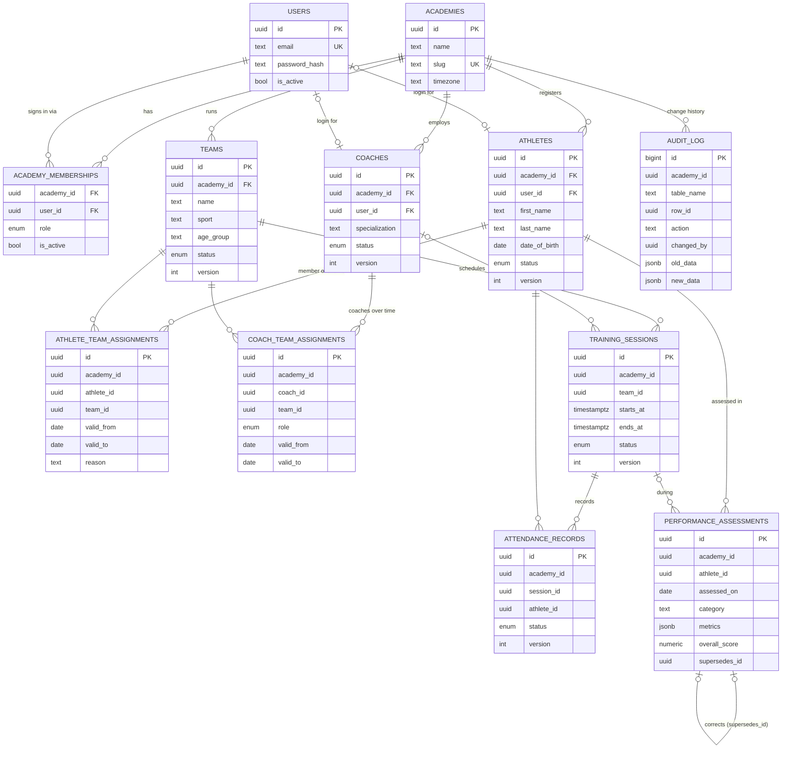
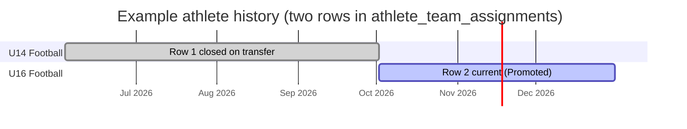
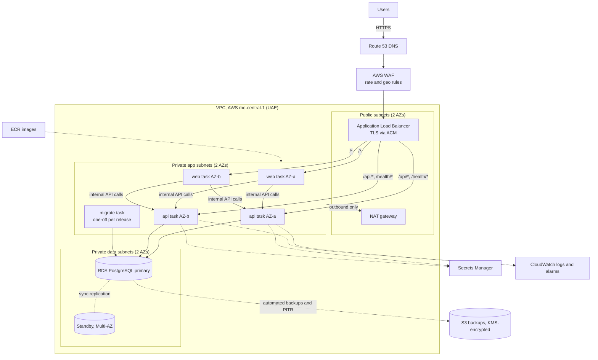
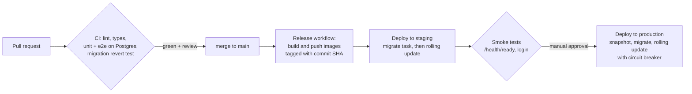

# Technical Proposal: Athlete & Coach Management Platform

**Scope:** technology selection, architecture, data and backend design, scalability, and production deployment for a multi-academy platform hosted in the UAE.

Everything described as *implemented* exists in this repository and is covered by automated tests. Anything that is a plan for production is labelled as such.

**Contents**

0. [Summary](#0-summary)
1. [Assumptions](#1-assumptions)
2. [Technology selection (A)](#2-technology-selection-a)
3. [Architecture (B)](#3-architecture-b)
4. [Data and backend design (C)](#4-data-and-backend-design-c)
5. [Scalability and reliability (D)](#5-scalability-and-reliability-d)
6. [Deployment strategy (E)](#6-deployment-strategy-e)
7. [Discussion scenarios](#7-discussion-scenarios)
8. [Decision summary: the five most important decisions](#8-decision-summary-the-five-most-important-decisions)
9. [What is implemented in the repository](#9-what-is-implemented-in-the-repository)

---

## 0. Summary

| Area | Decision |
| --- | --- |
| Architecture | **Modular monolith**: one NestJS API and one PostgreSQL database, split into domain modules with enforced boundaries |
| Data separation | **Shared schema with PostgreSQL row-level security (RLS)**, with academy-scoped composite foreign keys |
| History | **Effective-dated assignments** protected by exclusion constraints, append-only assessments, and a trigger-written audit log |
| Concurrency | **Optimistic locking** (`version`), idempotent upserts, and database constraints as the final arbiter |
| Frontend | Next.js as a thin backend-for-frontend; the token is kept in an httpOnly cookie |
| Hosting | **AWS me-central-1 (UAE)**: ECS Fargate, RDS PostgreSQL Multi-AZ, ALB, S3, Secrets Manager |
| Cost | About **USD 450/month** for production plus staging (estimate, ±25%) |

The guiding principle: **put the rules where they cannot be bypassed.** Tenant isolation, history immutability and scheduling conflicts are enforced by PostgreSQL. A bug in application code, a forgotten `WHERE` clause or a race between two users cannot break them.

---

## 1. Assumptions

| Brief says | How it shapes the design |
| --- | --- |
| 5,000 athletes, 300 coaches | Small data volumes. At about 3 sessions a week per athlete, attendance grows by roughly 0.8 M rows a year. PostgreSQL handles this on modest hardware for many years. |
| 100–200 concurrent users | Roughly 20–50 requests per second at peak, assuming one action every 4–10 seconds per active user. Two small API containers are plenty. |
| 5–10× growth | Up to about 2,000 concurrent users and about 500 req/s. This is still within a single primary database plus horizontally scaled API containers. No re-architecture is needed. |
| Small team | Choose the fewest moving parts: one language (TypeScript) across frontend and backend, one deployable API, managed database and containers, no Kubernetes. |
| Cloud in the UAE | Data residency: athlete data includes minors' personal data and performance records, which falls under the UAE Personal Data Protection Law (Federal Decree-Law 45/2021). All data, backups and logs stay in a UAE region. |

**Assumptions I added**

- **Academies onboard themselves.** An academy signs up on its own; the person signing up becomes its administrator, then creates teams, coaches, athletes and logins. Sign-up only accepts a new email, so it can never attach to, or return a session for, an existing account. It is rate-limited and can be switched off (`ALLOW_ACADEMY_SIGNUP=false`) if academies should instead be onboarded by the platform operator (`POST /platform/academies`).
- **Academies are independent customers.** No user may see another academy's data. One person, such as a coach working at two academies, can hold memberships in several academies and chooses one at sign-in.
- **Usage peaks** around training hours, typically afternoons and evenings in Gulf time. Weekly reporting is light.
- **Availability target:** 99.9% for the API. **RPO** (maximum data loss) of 5 minutes or less. **RTO** (time to recover) of 1 hour or less for a database failure. A sports-academy tool does not justify multi-region active-active.
- **History must be trustworthy.** Assignments and assessments are records that may be disputed by parents or academies, so they are corrected by adding a new record, never by overwriting.

---

## 2. Technology selection (A)

| Concern | Choice | Alternatives considered | Why this choice |
| --- | --- | --- | --- |
| Language | **TypeScript** (backend and frontend) | Java/Kotlin (Spring), C# (.NET), Go | One language for a small team, with shared mental models and types. Spring or .NET would be equally sound but adds a second ecosystem. Go has less mature batteries-included web frameworks for this kind of CRUD-heavy domain. |
| API framework | **NestJS 12** | Express/Fastify alone, Spring Boot | Modules, dependency injection, guards and interceptors map directly onto a modular monolith and cross-cutting concerns (authentication, tenancy, transactions). Plain Express would mean building that structure by hand. |
| Database | **PostgreSQL 17** | MySQL, MongoDB, DynamoDB | The domain is relational, with strong integrity needs. PostgreSQL uniquely offers **row-level security**, **exclusion constraints** (no overlapping date ranges), partial indexes, `jsonb` for sport-specific metrics, and mature managed hosting in the UAE. MongoDB or DynamoDB would push integrity into application code. |
| Data access | **TypeORM 1.x** | Prisma, Drizzle, raw SQL | Decorator entities fit NestJS. Hand-written migrations allow RLS, triggers and constraints. Raw SQL is used deliberately for reports and history queries. **Trade-off:** TypeORM's typing is weaker than Prisma's; we offset this with DTO validation and e2e tests. |
| Validation and docs | class-validator, @nestjs/swagger (compiler plugin) | Zod, hand-written OpenAPI | One source of truth: DTO classes drive both validation and the OpenAPI documentation (47 endpoints, fully described). |
| Authentication | Short-lived JWT, verified against the membership on **every request** | Server sessions in Redis, an external identity provider (Cognito, Auth0) | No extra infrastructure. Re-reading the membership gives instant revocation without a session store. An identity provider is a sensible later step if single sign-on or MFA is required (see §5.4). |
| Frontend | **Next.js 16** (App Router, server components) | React single-page app, Angular | Server-side data fetching keeps the token in an **httpOnly cookie**, never in browser JavaScript. The brief weights backend design over UI, so the frontend stays thin. |
| Runtime and hosting | Docker; **AWS ECS Fargate + RDS** in me-central-1 | Kubernetes (EKS), plain VMs, Azure UAE North | See decision 5 in §8. Containers without managing clusters or servers. |
| CI/CD | GitHub Actions | GitLab CI, Jenkins | The code is already on GitHub, and there is no CI server to run. |

**What I deliberately left out**, and the trigger that would bring each one in:

| Left out | Why not now | Would add it when |
| --- | --- | --- |
| Redis or another cache | Queries are indexed and fast at this scale | Profiling shows repeated hot reads, such as dashboards at 10× scale |
| Message broker (Kafka, RabbitMQ, SQS) | No asynchronous workflows yet | We need email or push notifications or bulk imports (start with SQS) |
| Microservices | A small team, one domain, and transactional consistency across modules | A module needs independent scaling or a separate team |
| Kubernetes | High operational cost for a small team | Many services, or a requirement to be portable across clouds |
| Elasticsearch | `ILIKE` on indexed names is enough | Full-text search across notes at large scale (try `pg_trgm` first) |

---

## 3. Architecture (B)

### 3.1 Components

```mermaid
flowchart LR
  subgraph Client
    B[Browser]
  end
  subgraph Frontend["Frontend (Next.js)"]
    SC[Server components<br/>and server actions]
  end
  subgraph Backend["Backend (NestJS modular monolith)"]
    direction TB
    G[Guards: rate limit, JWT and membership check, roles]
    I[Tenant transaction interceptor<br/>sets app.academy_id]
    subgraph Modules
      ID[identity]:::m
      AC[academies]:::m
      AT[athletes]:::m
      CO[coaches]:::m
      TE[teams<br/>+ TeamAccessService]:::m
      TR[training]:::m
      PE[performance]:::m
      AU[audit]:::m
      PL[platform]:::m
    end
    G --> I --> Modules
  end
  DB[(PostgreSQL<br/>RLS, constraints,<br/>audit triggers)]
  B -- "HTTPS, httpOnly cookie" --> SC
  SC -- "REST + Bearer JWT" --> G
  Modules -- "one transaction per request" --> DB
  classDef m fill:#eef2ff,stroke:#6366f1,color:#1e1b4b
```



1. **Browser.** It talks only to the frontend.
2. **Frontend.** Server components and server actions call the REST API. The JWT stays in an httpOnly cookie that browser JavaScript cannot read.
3. **Guard pipeline.** Each request passes through the API's guards: rate limiting, then the token check (which also re-reads the membership), then role checks.
4. **Tenant transaction interceptor.** It opens **one database transaction per request** and binds the academy with `set_config('app.academy_id', …, true)`.
5. **Domain module.** The module's service runs inside that transaction. Every query, including raw SQL, is filtered by row-level security.

### 3.2 How business logic is organised

```
backend/src/
  common/      cross-cutting only: auth guards, tenancy, error mapping, persistence helpers
  modules/
    <domain>/  entity  →  DTOs (validation)  →  service (rules)  →  controller (HTTP and roles)
```

**Module rules**, enforced by review and by module exports:

- **Ownership.** A module owns its tables. Other modules use its **exported services**, never its tables.
- **Example.** `training` and `performance` both ask `TeamAccessService` (exported by `teams`) whether *this coach may act on this team on this date*. The rule lives in exactly one place.
- **Communication.** Cross-module work is plain function calls inside one transaction. There are no internal HTTP calls and no distributed transactions.
- **Controllers.** They contain no business rules. Services contain no HTTP concerns.

### 3.3 Request lifecycle and tenant isolation

```mermaid
sequenceDiagram
  autonumber
  participant W as Next.js
  participant A as NestJS API
  participant P as PostgreSQL
  W->>A: GET /api/athletes (Bearer JWT)
  A->>A: Verify JWT signature and expiry
  A->>P: SELECT role FROM academy_memberships WHERE user=… AND academy=… AND is_active
  P-->>A: coach (access removed? → 401 immediately)
  A->>A: @Roles check
  A->>P: BEGIN; SELECT set_config('app.academy_id', $academy, true)
  A->>P: SELECT … FROM athletes … (no academy filter written in code)
  Note over P: RLS policy adds academy_id = app_current_academy()
  P-->>A: rows for this academy only
  A->>P: COMMIT (setting is discarded; a pooled connection carries no tenant)
  A-->>W: 200 JSON
```

### 3.4 Why a modular monolith, and its limits

**Why:**
- one deployable;
- one database transaction can span modules, for example a transfer that closes one assignment and opens another;
- a small team can reason about the whole system;
- local development is `./start.sh`.

Module boundaries keep the codebase navigable as it grows. They also mark where it could split later.

**Limitations, stated honestly:**
- **Shared fate.** A memory leak or a slow query in one module affects all of them. *Mitigation:* statement timeout (15 s), health checks, and horizontal API replicas.
- **No independent scaling** of modules. At the stated scale this does not matter. Read-heavy reporting is the first candidate to split off, or to point at a read replica.
- **Boundaries rely on discipline.** TypeScript does not stop one module importing another module's entity. *Mitigation:* code review, plus an ESLint import-boundary rule as a next step.
- **A transaction per request** holds a pooled connection for the whole request. That is fine for short CRUD requests. Long-running work such as imports and large reports should move to background jobs.

---

## 4. Data and backend design (C)

### 4.1 Core data model



**Key modelling choices**

- **Users are global; access is per academy.** One login can hold memberships in several academies. Athlete and coach *profiles* exist without a login, because most young athletes never sign in.
- **Assignments are rows with a date range, not a `team_id` column on the athlete.** This is what makes history possible.
- **Assessment metrics are `jsonb`.** Different sports measure different things (sprint times, shooting percentage), so there is no schema change per sport. A sortable `overall_score` keeps a common column for reporting.
- **Mutable rows carry a `version`.** History rows (assignments, assessments, audit entries) do not, because they are not edited.

### 4.2 Keeping academies apart: three independent layers

| Layer | Mechanism | What it stops |
| --- | --- | --- |
| 1. Identity | The academy comes **only from the verified token**, and the membership is re-checked on every request. A request body containing `academyId` is rejected (400). | Clients choosing another academy |
| 2. Row-level security | Every tenant table has the policy `USING (academy_id = app_current_academy())` and a `WITH CHECK` on writes. The API's database user has **no table ownership and no `BYPASSRLS`**. With no academy set, it sees **zero rows** (fails closed). | A forgotten `WHERE`, a raw-SQL report, an injection that reads too widely |
| 3. Composite foreign keys | Children reference parents through `(academy_id, id)`, for example `FOREIGN KEY (academy_id, team_id) REFERENCES teams (academy_id, id)`. | Linking a team in academy A to an athlete in academy B, even through direct SQL |

**Why a shared schema with RLS, rather than a database or schema per academy?** At about 5–50 academies:

- a database per academy multiplies migrations, connection pools, backups and cost;
- a schema per academy has the same migration-fan-out problem.

A shared schema with RLS gives strong isolation with a single migration path. **The exit route:** a very large academy that needs physical separation can be moved to its own database, because every row already carries `academy_id`.

**Pre-authentication paths** use narrow `SECURITY DEFINER` functions:
- `auth_lookup_user(email)` for login;
- `create_academy_user(...)`, which only ever adds a membership to the academy bound to the current transaction;
- `platform_create_academy(...)` for operator onboarding behind `PLATFORM_ADMIN_KEY`;
- `register_academy(...)` for self-service sign-up, which always creates a new user (an existing email fails on the unique index).

They are the only code paths that cross the RLS boundary, and each does one thing.

### 4.3 Data integrity

Constraints in the database (as implemented in the migrations):

```sql
-- No overlapping membership of the same athlete in the same team (half-open ranges)
CONSTRAINT athlete_team_no_overlap EXCLUDE USING gist (
  athlete_id WITH =, team_id WITH =, daterange(valid_from, valid_to, '[)') WITH &&)

-- A team cannot be double-booked (cancelled sessions do not count)
CONSTRAINT training_sessions_no_double_booking EXCLUDE USING gist (
  team_id WITH =, tstzrange(starts_at, ends_at, '[)') WITH &&) WHERE (status <> 'cancelled')

UNIQUE (session_id, athlete_id)            -- one attendance record per athlete per session
UNIQUE (supersedes_id)                     -- an assessment can be corrected only once
CHECK (ends_at > starts_at)  CHECK (valid_to IS NULL OR valid_to > valid_from)
CHECK (overall_score BETWEEN 0 AND 10)
```

**Rules that need context live in services:**
- attendance is accepted only for athletes on the session's team **on the session's date, in the academy's timezone**;
- a coach may assess only athletes on a team they coach on that date.

**Errors map to useful HTTP statuses.** Unique and exclusion violations return `409`, foreign-key and check violations return `422`, and a permission denial from the database returns `403`. They never surface as a generic `500`.

### 4.4 Historical records



| Row | team | valid_from | valid_to | reason |
| --- | --- | --- | --- | --- |
| 1 | U14 Football | 2026-06-04 | 2026-10-02 | — |
| 2 | U16 Football | 2026-10-02 | *null (current)* | Promoted |

- **Transfer.** In one transaction, lock the athlete row, close the open assignment (`valid_to = D`) and insert a new one (`valid_from = D`). There is no gap and no overlap.
- **Closing only.** Database grants allow the API to update **only** `valid_to` and `reason` on assignment tables. A trigger rejects any change to a row that has already been closed. There are **no `DELETE` grants** on any tenant table; records are archived with a status instead.
- **Point-in-time queries.** "Who was on U16 on 1 March?" is a single indexed query (`GET /teams/:id/roster?date=`).
- **Assessments are append-only.** A correction is a new row with `supersedes_id`. The runtime role has no `UPDATE` on that table.
- **Audit log.** A trigger records every insert and update on tenant tables: who (`app.user_id`), when, and the full row before and after. The trigger runs as `SECURITY DEFINER` and the API has **read-only** access, so entries cannot be forged or edited.

**Why not event sourcing?** It gives full history but costs projections, replay tooling and eventual consistency. Effective dating, append-only facts and a trigger-based audit log meet the brief's requirement with ordinary SQL.

### 4.5 Concurrent updates

| Situation | Mechanism | Outcome |
| --- | --- | --- |
| Two admins edit the same athlete | Optimistic locking: `UPDATE … SET …, version = version + 1 WHERE id = $1 AND version = $2` | The first save wins. The second gets **409** with `currentVersion`, and the UI asks the user to reload. Nothing is silently lost. |
| Two coaches submit attendance for the same session | `INSERT … ON CONFLICT (session_id, athlete_id) DO UPDATE` | One row per athlete. Repeating a submission is safe. The `version` increments so the change is visible. |
| Two transfers of the same athlete at once | `SELECT … FOR UPDATE` on the athlete, plus the exclusion constraint | The transfers run one after the other. An overlapping result is impossible. |
| Two coaches book the same slot | Exclusion constraint on `(team_id, tstzrange)` | The second booking gets **409**. A recurring series is all-or-nothing. |
| Two corrections of the same assessment | `UNIQUE (supersedes_id)` | The second gets **409**. |

**Optimistic over pessimistic locking**, because editing conflicts are rare and form editing takes human time; holding locks during that time would hurt. The end-to-end test *"turns a stale update into 409 Conflict"* fires two parallel `PATCH` requests and asserts exactly one `200` and one `409`.

### 4.6 API design

- **REST, JSON, resource-oriented.** 47 operations are fully documented in OpenAPI at `/docs`, generated from the code.
- **Representative routes:**
  - `GET /athletes?search=&teamId=&status=&page=`
  - `POST /athletes/:id/transfer`
  - `GET /teams/:id/roster?date=`
  - `POST /sessions/recurring`
  - `PUT /sessions/:id/attendance` (bulk, repeat-safe)
  - `GET /attendance/summary?teamId=&from=&to=`
  - `GET /audit?entity=&entityId=`
- **Behaviour.** List endpoints are paginated with a maximum of 100 items per page. Validation rejects unknown fields. `PATCH` requests require a `version`. Errors share one shape: `{ statusCode, message, constraint?, currentVersion? }`.
- **Authorization works at two levels:**
  - **coarse:** the role on each route (`@Roles`);
  - **fine:** the team-assignment rules in `TeamAccessService`, and athletes reading only their own records.

---

## 5. Scalability and reliability (D)

### 5.1 Scaling path

| Stage | Load | What changes |
| --- | --- | --- |
| Launch | 200 concurrent users | 2 API and 2 web tasks; `db.t4g.medium` Multi-AZ |
| 5× | about 1,000 users | Auto-scale API tasks on CPU (2→4). Add **RDS Proxy or PgBouncer in transaction mode**; it is compatible with our transaction-scoped `set_config`. |
| 10× | about 2,000 users, about 500 req/s | DB to `db.r7g.large`. Send reports and dashboards to a **read replica**. Run imports and notifications as background jobs (SQS plus a worker in the same codebase). |
| 50,000 athletes | 10× data | See scenario 3 (§7). Partition `audit_log` and `attendance_records` by month, and archive old audit data to S3. |

**The API is stateless.** There is no server-side session, so scaling out means adding tasks behind the load balancer.

### 5.2 If the database becomes the bottleneck

Work through these in order, cheapest first, and measure (Performance Insights, `pg_stat_statements`) before each step:

1. **Find and fix slow queries.** Add missing indexes. Every list endpoint already filters on indexed columns, and pagination keeps reads small.
2. **Connection pressure.** The per-request transaction holds a connection for the length of the request. Use RDS Proxy or PgBouncer, keep requests short, and keep the 15-second `statement_timeout`.
3. **Scale up.** A larger instance class takes minutes and is a single change in Terraform.
4. **Offload reads.** Point reporting endpoints (attendance summary, audit, dashboards) at a read replica.
5. **Cache genuinely hot, rarely changing reads** (academy settings, team lists) in Redis, with short TTLs.
6. **Partition** large append-only tables by time.
7. **Last resort: shard by academy.** Every table is already keyed by `academy_id`, so a very large academy can move to its own database.

### 5.3 Other critical components

| Component | Failure | Handling |
| --- | --- | --- |
| API task | Crash or memory leak | ECS restarts it. The ALB routes only to tasks passing `/health/ready`. At least 2 tasks run in 2 Availability Zones. |
| Database primary | Instance or AZ failure | RDS Multi-AZ fails over automatically in about 60–120 seconds. The app reconnects through its pool. |
| Bad deployment | Errors after release | The ECS deployment circuit breaker rolls back to the previous task definition (see §7, scenario 5). |
| Region outage | Rare, but serious | Cross-region copies of daily snapshots, and infrastructure as code to rebuild. RTO is hours, which is acceptable for this domain. |

### 5.4 Most significant technical risks

| Risk | Impact | Mitigation (without adding complexity) |
| --- | --- | --- |
| **Data leaking between academies** | Severe: privacy breach involving minors | Three-layer isolation (§4.2). The API's database role cannot bypass RLS. **E2E tests** assert cross-tenant reads, writes and links all fail. A migration checklist requires RLS on every new table. |
| **Schema migration breaks production** | Outage or data loss | Hand-reviewed migrations, expand/contract changes, a snapshot before each migration, and **CI applies, reverts and re-applies** every migration on a real PostgreSQL. |
| **Credential attacks / account takeover** | Unauthorised access | bcrypt (cost 12), the same response time for unknown emails, rate limiting (5 attempts per minute), instant revocation. **Next step:** MFA for admins through an identity provider (Cognito in me-central-1). |
| **Timezone errors** (a session counted on the wrong day) | Wrong attendance | All instants are stored as `timestamptz`. Each academy has an IANA timezone. "Session date" is computed in SQL (`AT TIME ZONE academy.timezone`). |
| **Small team / bus factor** | Slow recovery from incidents | Managed services, infrastructure as code, a one-command local setup, READMEs per project, and a runbook for restores. |
| **Regulatory: data residency (PDPL)** | Legal exposure | Single UAE region for data, backups and logs. Encryption at rest (KMS) and in transit (TLS). An audit log of access changes. |
| **Connection exhaustion under load** | Slow or failed requests | Bounded pool (`DB_POOL_MAX`), statement timeout, RDS Proxy at 5×. |

---

## 6. Deployment strategy (E)

### 6.1 Hosting choice

**AWS me-central-1 (UAE)** was chosen for:
- three Availability Zones in the UAE;
- managed PostgreSQL with Multi-AZ and point-in-time recovery;
- ECS Fargate (containers without servers to patch);
- the KMS, Secrets Manager and WAF services we need, all in the region.

**Azure UAE North** (Dubai) is an equally valid alternative, using Container Apps and Azure Database for PostgreSQL Flexible Server. The choice could follow an existing cloud agreement. The design has no AWS-specific application code; the only coupling is the infrastructure code.

### 6.2 Production infrastructure



### 6.3 Environments

| Environment | Purpose | Shape |
| --- | --- | --- |
| **Local** | Development | `./start.sh` (Docker Compose: PostgreSQL, migrate, API, web) |
| **CI** | Every push and pull request | Lint, typecheck, unit tests; PostgreSQL service with migrate, revert, re-apply and e2e; Docker image builds |
| **Staging** | Pre-production checks and demos | Same Terraform as production at smaller sizes: 1 task each, single-AZ `db.t4g.small`. Anonymised or seeded data only. |
| **Production** | Live | As in §6.2 |

All three cloud environments are defined in **one Terraform codebase with per-environment variables**, so staging stays a faithful copy of production.

### 6.4 Security

- **Network:**
  - only the ALB is public;
  - the API and database sit in private subnets;
  - security groups allow ALB→web and API, web→API, and API→database (5432) only.
- **Encryption:**
  - TLS 1.2+ at the ALB;
  - RDS and S3 encrypted with KMS;
  - TLS from the API to the database (`DB_SSL=true`).
- **Secrets:**
  - `JWT_SECRET`, database passwords and `PLATFORM_ADMIN_KEY` live in Secrets Manager and are injected as task environment variables;
  - nothing is committed (only `.env.example` files are);
  - secrets are rotated quarterly.
- **Database roles:**
  - the migration (owner) role is used only by the migrate task;
  - the API uses a role without ownership or `BYPASSRLS`, with no `DELETE` grants.
- **Application:**
  - validation with unknown fields rejected;
  - rate limiting;
  - CORS limited to the web origin;
  - Swagger disabled in production;
  - httpOnly, `Secure`, `SameSite=Lax` cookies;
  - WAF managed rules.
- **Operations:**
  - least-privilege IAM per task;
  - GitHub OIDC to AWS (no long-lived keys);
  - CloudTrail on;
  - audit log for data changes.

### 6.5 CI/CD



- **CI** (`.github/workflows/ci.yml`, *implemented*) runs on every push and pull request. It includes **apply → revert → re-apply** of all migrations against a real PostgreSQL, so every change proves it can roll back.
- **Release** (`.github/workflows/release.yml`, *implemented*) runs on `main` and version tags. It builds both images once and pushes them to GitHub Container Registry, tagged with the commit SHA and the version. The deploy job copies the chosen tag to **ECR in me-central-1**, so production pulls images from inside the UAE region.
- **Deploy** (*plan*) uses the same images in every environment. The steps are:
  1. take an RDS snapshot;
  2. run the `migrate` task (the same image, with the command `migration:run:prod`);
  3. do a rolling ECS update with `minimumHealthyPercent=100`;
  4. let the circuit breaker roll back if health checks fail.

  Production requires a manual approval in GitHub Environments.

### 6.6 Backups and recovery

| What | How | Target |
| --- | --- | --- |
| Database | RDS automated backups with **point-in-time recovery (35 days)**; daily snapshots copied to a second region; snapshot before every release | **RPO ≤ 5 minutes** |
| Database failure | Multi-AZ automatic failover | **RTO about 2 minutes** |
| Corruption or bad data | Point-in-time restore to a new instance, verify, switch the app over | **RTO ≤ 1 hour** |
| Region loss | Restore from the cross-region snapshot using Terraform | RTO about 4–8 hours (accepted) |
| Infrastructure | Terraform in Git | Rebuildable |
| Verification | **Monthly restore drill** into staging, with the time recorded | A runbook that has been proven to work |

### 6.7 Indicative monthly cost (production + staging)

These are **estimates for planning**, based on public on-demand pricing. Prices in me-central-1 typically run roughly 10–20% above us-east-1. Confirm with the AWS Pricing Calculator before committing.

| Item | Production | Staging | Assumption |
| --- | --- | --- | --- |
| ECS Fargate | ~$85 | ~$25 | Prod: 4 tasks (2 API + 2 web) × 0.5 vCPU / 1 GB, 24×7. Staging: 2 tasks. |
| RDS PostgreSQL | ~$125 | ~$30 | Prod: `db.t4g.medium` Multi-AZ, 50 GB gp3. Staging: `db.t4g.small` single-AZ. |
| Application Load Balancer | ~$30 | ~$20 | Light traffic |
| NAT gateway | ~$40 | ~$40 | 1 per environment, low data transfer |
| CloudWatch logs and metrics | ~$20 | ~$5 | 30-day retention |
| Backups (S3 and snapshots) | ~$15 | ~$2 | PITR storage plus a cross-region copy |
| WAF, Secrets Manager, ECR, Route 53, KMS | ~$25 | ~$5 | |
| **Total** | **≈ $340** | **≈ $125** | **≈ $465/month**, ±25% |

**Cheaper staging:** scale staging to zero outside working hours (schedule desired count = 0). This saves about $60 a month.

**At 10× load,** expect about $700–900 a month: a larger database class, a read replica, 4–6 API tasks and RDS Proxy. Cost grows roughly linearly with load, with no step changes.

---

## 7. Discussion scenarios

### 1. The infrastructure budget is reduced by 40% (about $465 → $280)

Cut redundancy where the business impact is lowest; never cut isolation or backups.

1. **Staging:** run it on a schedule (off at night and weekends), or share one small database instance between staging and CI preview. Saves about $60–80.
2. **NAT gateways:** replace them with VPC endpoints for ECR, Secrets Manager and CloudWatch, or put tasks in public subnets with locked-down security groups. Saves about $40–80.
3. **Production database:** move from Multi-AZ to single-AZ, keeping PITR. The RTO for a database host failure rises from about 2 minutes to about 30–60 minutes (restore). Saves about $60.
4. **Compute:** 1 web task plus 2 API tasks, using Graviton and a Savings Plan. Saves about $25.
5. Consider the single-server option in the next scenario for staging.

**Trade-off made explicit:** a slower recovery from rare infrastructure failures, in exchange for about 40% lower cost. Isolation, backups and the 5-minute RPO are unchanged.

### 2. The application must initially run on a single server

This is already supported: the repository's Docker Compose stack *is* the single-server deployment.

- **Server:** one EC2 instance in me-central-1, such as a `t4g.large` (2 vCPU / 8 GB, about $70–90 a month).
- **Software:** Docker Compose running PostgreSQL, migrate, the API and the web app, with **Caddy** in front for automatic TLS.
- **Backups (non-negotiable on one box):**
  - nightly `pg_dump` to S3;
  - plus continuous WAL archiving with **wal-g** to S3 for point-in-time recovery (RPO about 5 minutes);
  - EBS snapshots daily.
- **What we lose:** no high availability (a host failure means restoring onto a new instance, RTO about 1 hour), and maintenance windows for OS patches.
- **Path out:** the same images move to ECS, and the database moves to RDS through `pg_dump`/restore or AWS DMS. No code changes are needed.

### 3. The number of athletes grows to 50,000

- **Data:** about 8 M attendance rows a year and a fast-growing `audit_log`. That is still modest for PostgreSQL.
- **Actions:**
  - monthly partitioning for `audit_log` and `attendance_records`, archiving audit data older than 2 years to S3;
  - check the composite indexes for hot queries such as the athlete list by academy and name (already indexed);
  - `pg_trgm` for name search if `ILIKE` slows down;
  - dashboards and reports on a read replica;
  - API auto-scaling to 4–6 tasks;
  - RDS Proxy;
  - database moved to `db.r7g.large`.
- **No change** to the architecture, the API contract or the isolation model. If one academy becomes very large, it can move to its own database, because every row is keyed by `academy_id`.

### 4. Two users update the same record simultaneously

This is handled today and covered by tests (§4.5).

- **Editable records:** optimistic locking. The second writer gets **409** and the current version; the UI asks them to reload and re-apply. No silent overwrite happens.
- **Attendance:** an idempotent upsert, so both submissions converge.
- **Assignments, bookings and corrections:** database constraints serialise the conflict and return 409.
- **Why not "last write wins"?** It silently discards one coach's work. **Why not pessimistic locks?** Editing takes human time, and locks would block other users.

### 5. A deployment fails after a database schema change

**Prevention:**
- every migration is reviewed SQL;
- CI applies, **reverts** and re-applies each migration;
- **expand/contract**: add new columns or tables in release N, switch code in N+1, drop the old ones in N+2;
- with expand/contract, the *previous* application version always works against the *new* schema.

**During deploy:**
1. snapshot;
2. the `migrate` task runs each migration **in its own transaction** (`migrationsTransactionMode: 'each'`);
3. if a migration fails, it rolls back and the deploy stops, with the old version still running;
4. if migrations succeed but the new app fails health checks, the **ECS circuit breaker** reverts to the previous task definition, which is compatible because of expand/contract.

**Recovery options, in order:**
1. roll back the application only (usual case, minutes);
2. run `migration:revert` for the specific migration (tested in CI);
3. as a last resort for destructive mistakes, point-in-time restore to just before the migration.

### 6. A proposed technology adds significant operational complexity without a clear business benefit

**Apply a simple test.** Which **measured** problem does it solve? What does it cost to run, secure and staff on-call? Is there a simpler option inside the current stack?

| Proposal | Problem it claims to solve | Answer for this platform |
| --- | --- | --- |
| Kubernetes | Orchestration | ECS Fargate already provides rolling deploys, auto-scaling and self-healing, with no cluster to operate. **No.** |
| Microservices | Team or scale independence | One small team; the modules already give the code structure. **No**, until a module needs independent scaling or ownership. |
| Kafka | Event streaming | No streaming use case. If background jobs are needed, use SQS. **No.** |
| Redis | Speed | Not until profiling shows hot reads that indexes cannot fix. **Not yet.** |
| GraphQL | Flexible client queries | One first-party client, and REST with OpenAPI is simpler to secure and cache. **No.** |

**Decision rule:** adopt it only when a metric or a requirement demands it. Write the decision up as an Architecture Decision Record (ADR) with the trigger, the cost and the exit plan.

---

## 8. Decision summary: the five most important decisions

### Decision 1: Modular monolith (NestJS) instead of microservices

| | |
| --- | --- |
| **Chosen** | One API process with domain modules and enforced exports, and one database |
| **Alternatives** | Microservices per domain; a plain layered monolith with no module boundaries |
| **Why** | Cross-domain operations (transfers, attendance validation against rosters) need one ACID transaction. A small team and modest load don't justify distributed systems. Modules keep the code navigable and mark where it could split later. |
| **Trade-offs** | Shared fate and scaling are all-or-nothing; boundaries rely on discipline (mitigated by review and lint rules). |

### Decision 2: Shared schema with PostgreSQL row-level security for academy isolation

| | |
| --- | --- |
| **Chosen** | One schema; an `academy_id` on every table; RLS policies; a database role that cannot bypass RLS; composite tenant foreign keys |
| **Alternatives** | Filtering in the application only; a schema per academy; a database per academy |
| **Why** | Isolation is enforced **in the database**, so it holds even with application bugs. There is one migration path and one connection pool. It is cheap at 5–50 academies. |
| **Trade-offs** | RLS adds a predicate to every query (negligible with indexes). It requires discipline on new tables (migration checklist and e2e tests). Noisy-neighbour risk is managed by scaling up, or by moving a large academy to its own database. |

### Decision 3: Effective-dated assignments and append-only facts for history

| | |
| --- | --- |
| **Chosen** | `valid_from` / `valid_to` rows protected by exclusion constraints and a trigger; append-only assessments with `supersedes_id`; a trigger-written audit log |
| **Alternatives** | A current `team_id` column plus a separate history table; event sourcing; temporal-table extensions |
| **Why** | History *is* the data, so a roster on any date is a single query. The database guarantees no overlaps and no rewrites. It is plain SQL that any developer understands. |
| **Trade-offs** | Queries must include date predicates (centralised in one helper). The audit log grows quickly (partitioning and archiving at scale). |

### Decision 4: Optimistic concurrency with database constraints as the final arbiter

| | |
| --- | --- |
| **Chosen** | A `version` on mutable rows (409 on stale writes); idempotent upserts; row locks only for short transfers; unique and exclusion constraints |
| **Alternatives** | Last write wins; pessimistic locking during edits; application-level checks only |
| **Why** | Conflicts are rare, and losing a coach's work silently is unacceptable. Constraints catch races that application checks miss (check-then-insert). |
| **Trade-offs** | Clients must send `version` and handle 409 (the UI shows a "reload" message). There are slightly more round-trips on conflict. |

### Decision 5: Managed containers in a UAE region (ECS Fargate + RDS in me-central-1)

| | |
| --- | --- |
| **Chosen** | Docker images on ECS Fargate behind an ALB; RDS PostgreSQL Multi-AZ; Terraform; GitHub Actions |
| **Alternatives** | Kubernetes (EKS); self-managed VMs; PaaS hosting outside the UAE; Azure UAE North |
| **Why** | Meets data residency. No servers or clusters to run. High availability across AZs out of the box. The same images run locally, in CI and in production. About $465 a month, and it fits a small team. |
| **Trade-offs** | Some AWS lock-in at the infrastructure layer only; the app is cloud-neutral. Fargate costs more per vCPU than EC2, which we accept in exchange for no patching. Multi-region is not included. |

---

## 9. What is implemented in the repository

| Proposal item | Location |
| --- | --- |
| Modular monolith, guards, tenant transactions | `backend/src/common`, `backend/src/modules` |
| Schema, RLS, constraints, triggers, grants | `backend/src/database/migrations/` |
| 47 documented REST endpoints | Swagger at `http://localhost:5001/docs` |
| Optimistic locking, idempotent attendance, recurring series | `common/persistence/optimistic-update.ts`, `modules/training` |
| Academy self-sign-up, audit log, platform onboarding, user and access management | `modules/identity`, `modules/audit`, `modules/platform` |
| Security and integrity tests | `backend/test/*.e2e-spec.ts` (17 scenarios) |
| Web app for all features and roles | `frontend/` |
| Single-server / local deployment | `backend/docker-compose.yml`, `frontend/docker-compose.yml`, `start.sh` |
| CI (including migration rollback test) and release images | `.github/workflows/ci.yml`, `.github/workflows/release.yml` |

**Planned for production, not in the repository:**
- Terraform for §6.2;
- the deploy job to ECS;
- monitoring dashboards and alarms;
- MFA through an identity provider.
